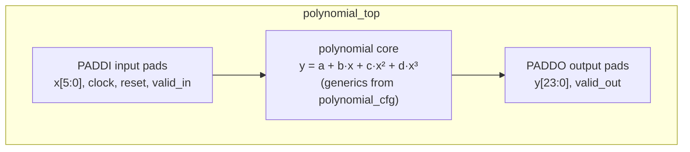
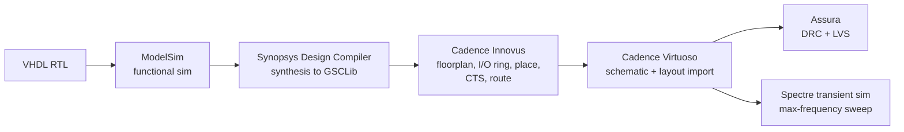
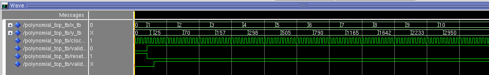
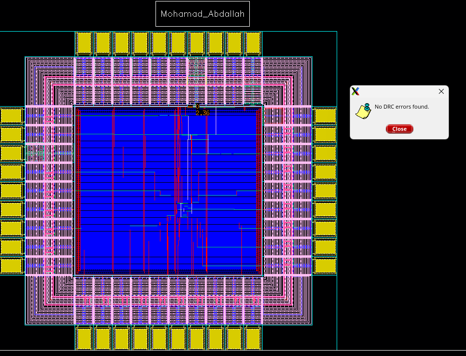
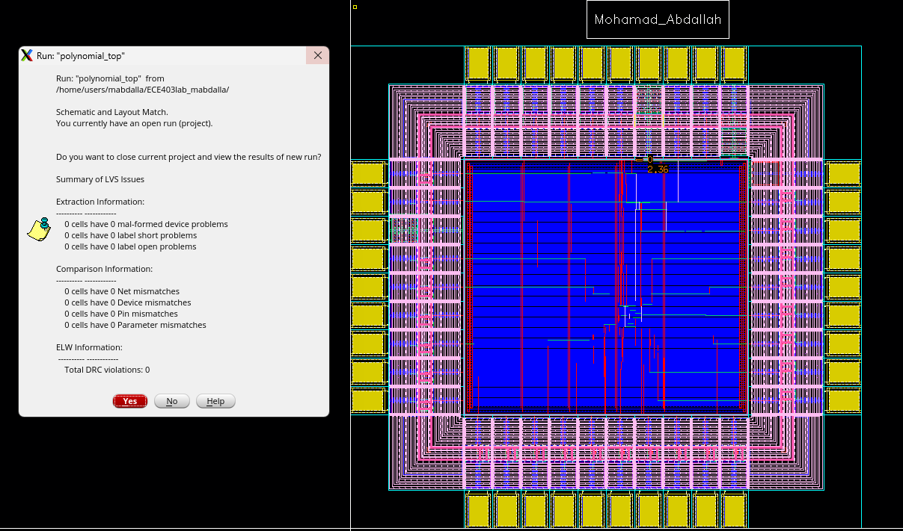
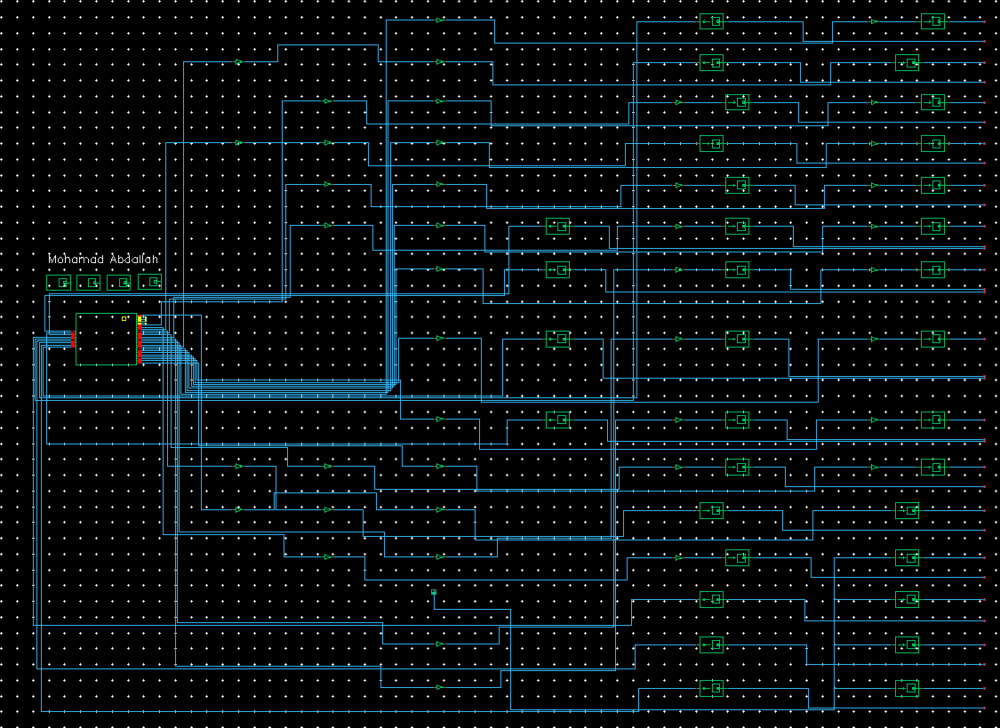
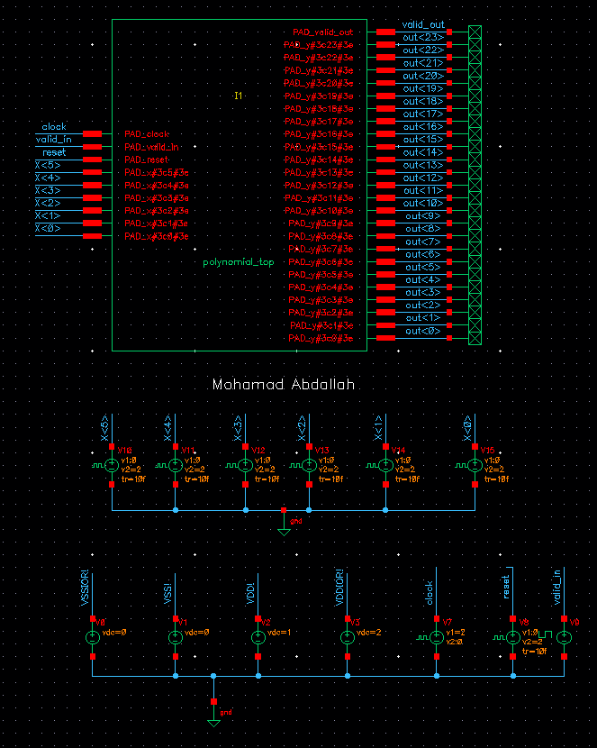
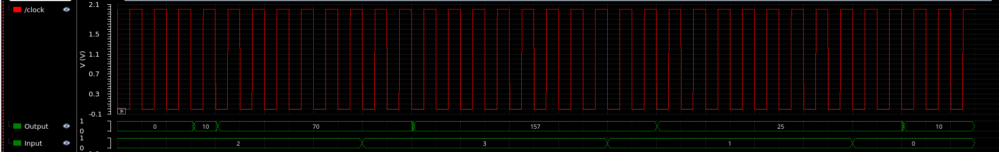
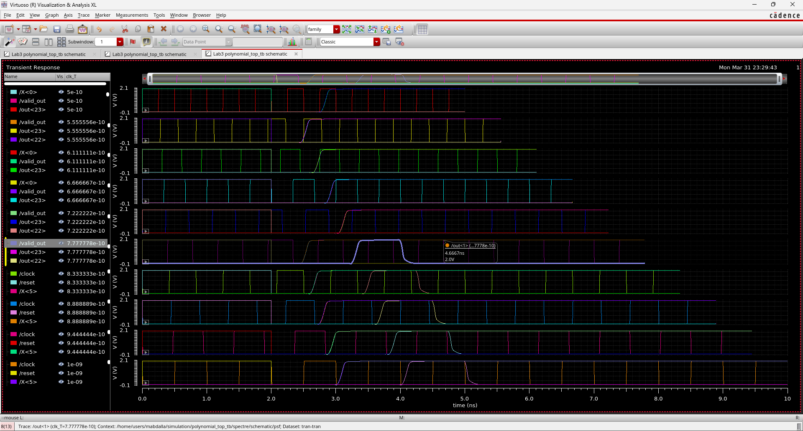

# Polynomial Solver ASIC

A cubic-polynomial evaluator taken from VHDL all the way to a DRC/LVS-clean 45 nm layout with an I/O pad ring. Built for **ECE 403, Lab 3 (Digital Design Flow)** at the University of Alberta, Winter 2025.

The chip takes a 6-bit unsigned input `x` and returns a 24-bit unsigned result:

$$y = 2x^3 + 9x^2 + 4x + 10$$

Each student was assigned their own coefficients. This design uses `a = 10`, `b = 4`, `c = 9`, `d = 2` in the generic form `y = a + b·x + c·x² + d·x³`. See [docs/polynomial.md](docs/polynomial.md) for how this was confirmed against the simulation results.

| | |
|---|---|
| Technology | gpdk45 (45 nm), GSCLib standard cells |
| Max clock (schematic-level sim) | ≈ 1.29 GHz (0.777 ns period) |
| Timing | Setup and hold met at every Innovus stage (0 violating paths) |
| Physical verification | Assura DRC clean, LVS clean |
| I/O | 34 signal pads + 4 supply pads + 4 corner cells |

> **Repository status:** This is a portfolio write-up rebuilt from the submitted lab report. It is not a complete source release. The report included the configuration package and the top-level pad wrapper, but its `Polynomial.vhd` and `Polynomial_top_tb.vhd` sections are copies of the wrapper, so **the polynomial core and the testbench are missing**. They have not been recreated here. A Python reference model ([model/polynomial_model.py](model/polynomial_model.py)) is included instead to document the expected behaviour.

## How it works



- [`rtl/polynomial_cfg.vhd`](rtl/polynomial_cfg.vhd) holds the assigned coefficients and bus widths as constants.
- [`rtl/polynomial_top.vhd`](rtl/polynomial_top.vhd) wraps the core: every input goes through a `PADDI` input pad and every output through a `PADDO` output pad. The coefficients are passed to the core as generics, so changing the polynomial only means editing the config package.
- The core is clocked and uses a `valid_in` / `valid_out` handshake: drive `x`, assert `valid_in`, and read `y` when `valid_out` goes high.

### Top-level ports

| Port | Direction | Width | Description |
|---|---|---:|---|
| `PAD_clock` | in | 1 | System clock |
| `PAD_reset` | in | 1 | Reset |
| `PAD_valid_in` | in | 1 | Marks `PAD_x` as valid |
| `PAD_x` | in | 6 | Input `x`, unsigned (0–63) |
| `PAD_valid_out` | out | 1 | Marks `PAD_y` as valid |
| `PAD_y` | out | 24 | Result `y`, unsigned |

The largest possible result is `y(63) = 536,077`, which needs 20 bits, so the 24-bit output cannot overflow.

## Design flow



Details of each step, the full timing summaries and the pad placement are in [docs/design-flow.md](docs/design-flow.md).

## Results

### Functional simulation (ModelSim)

The RTL simulation steps `x` from 0 to 10. Every output matches `2x³ + 9x² + 4x + 10`:

| x | 0 | 1 | 2 | 3 | 4 | 5 | 6 | 7 | 8 | 9 | 10 |
|---|---|---|---|---|---|---|---|---|---|---|---|
| y | 10 | 25 | 70 | 157 | 298 | 505 | 790 | 1165 | 1642 | 2233 | 2950 |

 <br>
*ModelSim waveform: `x_tb` steps through 0–10 and `y_tb` shows the matching results.*

### Timing (Cadence Innovus)

| Stage | Check | WNS (ns) | TNS (ns) | Violating paths |
|---|---|---:|---:|---:|
| Pre-CTS | Setup | 0.116 | 0.000 | 0 |
| Post-CTS | Setup | 0.238 | 0.000 | 0 |
| Post-CTS | Hold | 0.249 | 0.000 | 0 |
| Post-route | Setup | 0.821 | 0.000 | 0 |
| Post-route | Hold | 0.256 | 0.000 | 0 |

No max-capacitance, max-transition, max-fanout or max-length violations at any stage, and 0% routing overflow.

### Layout and physical verification

 <br>
*Final layout with the pad ring: Assura DRC clean.*

 <br>
*Assura LVS: layout matches the schematic.*

 <br>
*Schematic view imported into Virtuoso.*

### Transistor-level simulation (Virtuoso)

 <br>
*Testbench driving the chip's pads.*

 <br>
*Transient simulation with inputs 2, 3, 1, 0 giving outputs 70, 157, 25, 10.*

 <br>
*Parametric sweep of the clock period. The shortest period that still gave a valid output was 0.777 ns, so the maximum clock frequency is about 1.29 GHz.*

The post-layout (SPEF-annotated) comparison was not completed, so the frequency above is from the schematic-level simulation.

## Repository layout

```text
polynomial-solver-asic/
├── README.md
├── rtl/
│   ├── polynomial_cfg.vhd      # assigned coefficients and bus widths
│   ├── polynomial_top.vhd      # top level: pad wrapper around the core
│   └── README.md
├── pnr/
│   └── polynomial_top.io       # Innovus I/O pad placement file
├── model/
│   └── polynomial_model.py     # Python reference model + check against sim results
├── docs/
│   ├── polynomial.md           # the polynomial and how it was confirmed
│   └── design-flow.md          # tool flow, timing summaries, pad ring
└── assets/
    └── screenshots/            # ModelSim, Virtuoso and Assura screenshots
```

## Tools

ModelSim (Mentor Graphics) · Design Compiler / Design Vision (Synopsys) · Innovus 21.17 (Cadence) · Virtuoso, Spectre and Assura (Cadence) · gpdk45 / GSCLib
