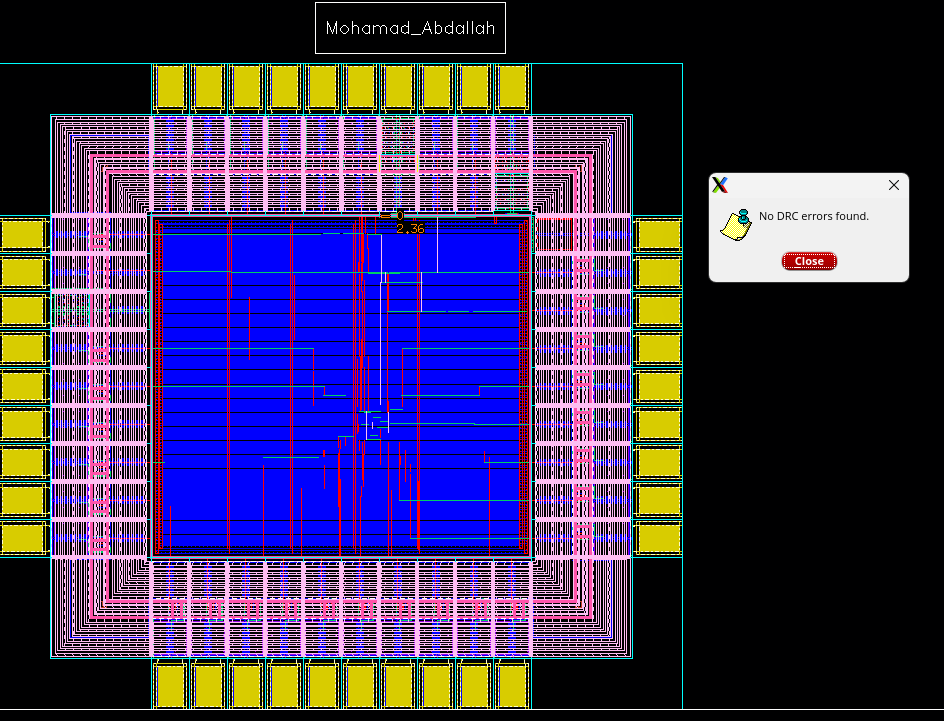
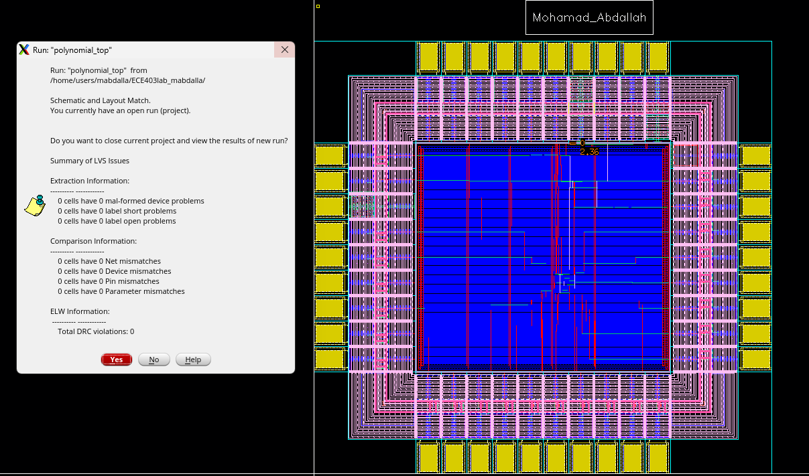
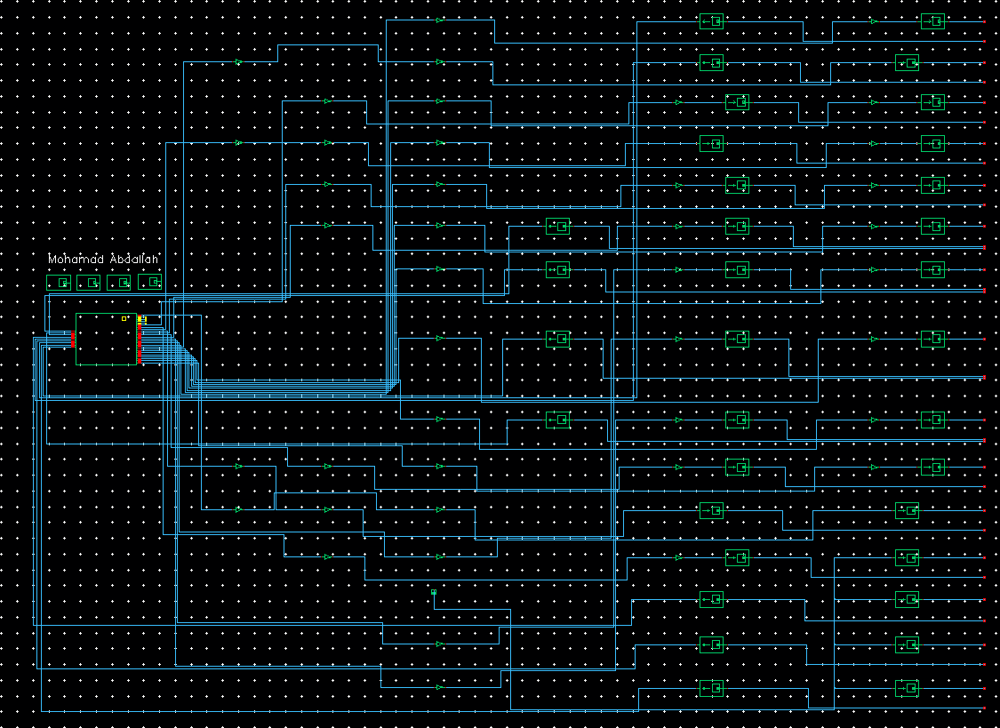
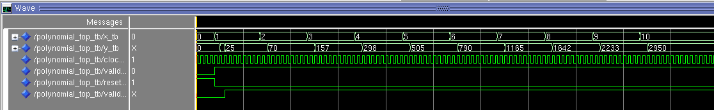
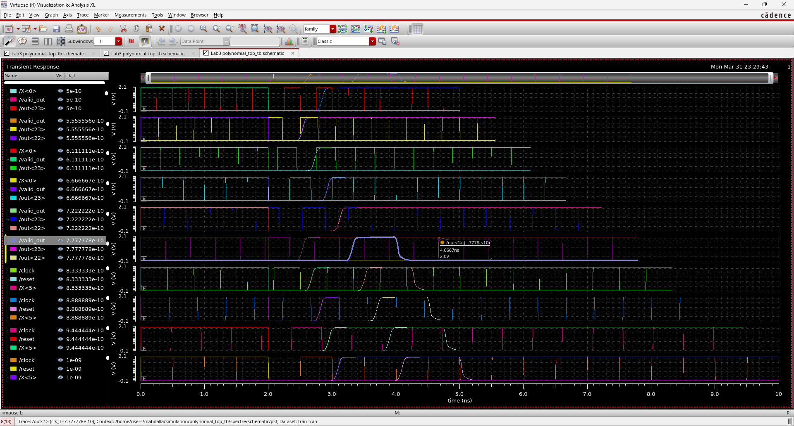
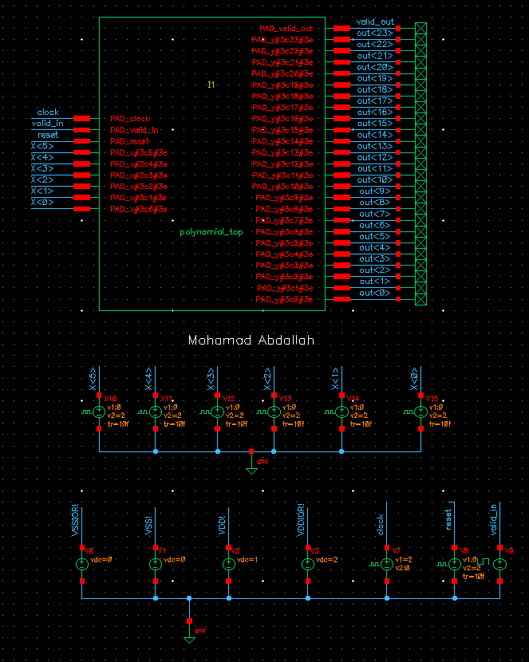

# Polynomial Solver ASIC

A VHDL polynomial-solver design taken from an ECE 403 digital-design / ASIC implementation project. The submitted project report documents functional simulation, an Innovus physical-design flow, Assura DRC/LVS checks, timing summaries, and a post-layout parametric simulation.

> **Repository status:** This is a portfolio scaffold reconstructed from the submitted lab report, not a complete, independently reproducible source release. The report contains the configuration package and top-level pad-wrapper source, but the section labelled `Polynomial.vhd` repeats the top-level wrapper instead of containing the polynomial-core implementation. The section labelled `Polynomial_top_tb.vhd` also repeats the wrapper rather than providing a testbench. Those missing source files have deliberately not been fabricated.

## Design configuration

The configuration package in [`rtl/polynomial_cfg.vhd`](rtl/polynomial_cfg.vhd) sets:

| Parameter | Value |
|---|---:|
| `a` | 10 |
| `b` | 4 |
| `c` | 9 |
| `d` | 2 |
| Input width | 6 bits |
| Output width | 24 bits |

The top-level entity in [`rtl/polynomial_top.vhd`](rtl/polynomial_top.vhd) exposes clock, reset, valid-in/valid-out, a 6-bit input bus, and a 24-bit output bus. It instantiates a `polynomial` core and maps signals through `PADDI` and `PADDO` I/O pad components.


## Work done in this lab:

- VHDL design and ModelSim functional simulation.
- Cadence Innovus placement, clock-tree synthesis, routing, and timing analysis.
- I/O pad integration and pad-ring layout.
- Cadence Virtuoso schematic/layout views.
- Cadence Assura DRC and LVS verification.
- Post-layout parametric simulation.


## Repository layout

```text
polynomial-solver-asic/
├── README.md
├── rtl/
│   ├── polynomial_cfg.vhd
│   ├── polynomial_top.vhd
│   └── README.md
└── assets/
    └── screenshots/
        └── README.md
```

## Screenshots:


*Circuit Layout showing clean DRC checks*


*Circuit Layout showing clean LVS checks*


*Circuit schematic*


*Modelsim Simulation*


*Virtuoso Simulation to Find Highest Frequency*


*Testbench Schematic*
